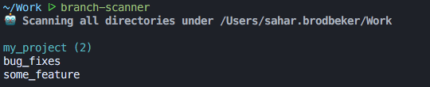
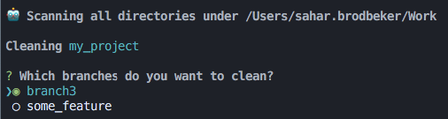

# npx branch-scanner [](https://www.npmjs.com/package/npx branch-scanner)

A CLI utility that lists and cleans non-standard git branches and worktrees across your local repositories.



## Table of Contents

- [Installation and Usage](#installation-and-usage)
    * [Options](#options)
    * [Commands](#commands)
        * [`scan`](#scan)
        * [`clean`](#clean)

## Installation and Usage

Run directly with npx — no install needed:
```sh
npx npx branch-scanner
```

### Options

| Option | Alias | What it does | Default |
|--------|-------|--------------|---------|
| `-v` | `--version` | Output the program's version number. | - |
| `-d` | `--directory` | Specify a directory to target. | Current directory |
| `-r` | `--recursive` | Recursively scan subdirectories. | `false` |
| `-h` | `--help` | Output usage information. | - |

By default, commands operate on the specified directory itself. Use `--children` to scan its subdirectories instead.

### Commands

#### `scan`

Lists all non-standard branches and linked worktrees for the target directory.

Worktrees are displayed with a 🌿 icon and their disk path.

```sh
# scan the current directory
npx branch-scanner scan

# scan a specific repo
npx branch-scanner -d ~/dev/myrepo scan

# scan all repos under a directory
npx branch-scanner -d ~/dev scan --children

# scan recursively
npx branch-scanner -d ~/dev scan --children -r
```

| Option | What it does |
|--------|--------------|
| `-c, --children` | Scan subdirectories instead of the directory itself. |

#### `clean`

Interactive UI to select and delete branches and/or worktrees.

Branches checked out in a worktree are shown only as worktrees (not duplicated).



```sh
# interactive clean on a specific repo
npx branch-scanner -d ~/dev/myrepo clean

# remove all worktrees non-interactively
npx branch-scanner -d ~/dev/myrepo clean --worktrees

# interactive clean across all repos in a directory
npx branch-scanner -d ~/dev clean --children
```

| Option | What it does |
|--------|--------------|
| `-c, --children` | Target subdirectories instead of the directory itself. |
| `--worktrees` | Non-interactive: remove all linked worktrees without prompting. |
| `--debug` | Print debug information during execution. |

> **Note:** Removing a worktree deletes its directory and prunes the git metadata. For large repos with `node_modules`, this can take a moment.
